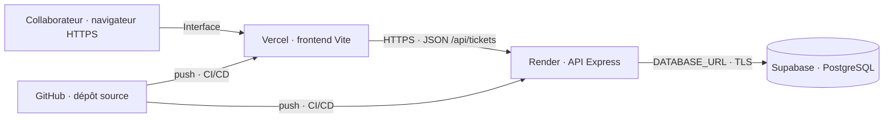

# GROUPE : Alexy Derbes // Sylvain Pottier // Ayrton Blondeau

# Clair — application de suivi des tickets

Application web trois tiers pour déclarer des demandes informatiques, consulter leur état et suivre leur résolution. Le frontend Vite est hébergé sur Vercel, l'API Express sur Render et les données sont conservées dans PostgreSQL sur Supabase.

## Architecture



Le navigateur ne reçoit jamais les identifiants PostgreSQL. Seul le backend utilise `DATABASE_URL`. Le frontend communique avec l'API en HTTPS et la liste des origines autorisées est contrôlée côté backend.

## Fonctionnalités

- Lire la liste des tickets, filtrer par statut et rechercher dans leur titre ou description.
- Créer un ticket avec un titre et une description validés.
- Faire évoluer son statut entre **Ouvert**, **En cours** et **Résolu**.
- Conserver les données dans PostgreSQL après actualisation et redémarrage.
- Vérifier l'API et la base via `GET /health`.

## Lancer en local

Prérequis : Node.js 20 ou supérieur et une base PostgreSQL accessible.

1. Créer la base `tickets`, puis exécuter `database/schema.sql` dans PostgreSQL ou dans l'éditeur SQL Supabase.
2. Copier `backend/.env.example` vers `backend/.env` et compléter `DATABASE_URL`.
3. Copier `frontend/.env.example` vers `frontend/.env` (la valeur locale par défaut convient).
4. Depuis la racine, lancer `npm install`, `npm install --prefix backend`, `npm install --prefix frontend`, puis `npm run dev`.
5. Ouvrir l'adresse Vite affichée (par défaut `http://localhost:5173`). L'API écoute sur `http://localhost:3000`.

Ne versionnez jamais les fichiers `.env`.

### Démo locale sans base distante

Une version de démonstration peut aussi fonctionner sans PostgreSQL ni API : depuis `frontend`, lancer `npm install`, puis `npm run dev -- --port 5173`. Ouvrir `http://127.0.0.1:5173`. Si l'API n'est pas disponible, l'interface charge des tickets exemples et conserve les créations et changements de statut dans le stockage local du navigateur. Ce mode sert à explorer l'interface; il ne partage pas les tickets avec les autres appareils.

## Mise en production

### 1. GitHub

Créer un dépôt GitHub vide, puis depuis le dossier du projet :

```bash
git init
git add .
git commit -m "feat: application de suivi des tickets"
git branch -M main
git remote add origin https://github.com/VOTRE-ORGANISATION/gestion-tickets.git
git push -u origin main
```

### 2. Supabase PostgreSQL

Créer un projet Supabase et exécuter `database/schema.sql` dans **SQL Editor**. Copier la chaîne de connexion PostgreSQL du projet (format URI) pour l'ajouter comme secret `DATABASE_URL` au service Render. Cette valeur reste privée; ne la placez pas dans Vercel ou dans le code frontend.

### 3. API sur Render

Créer un **Web Service** depuis le dépôt GitHub. Utiliser le dossier racine `backend`, la commande de construction `npm install`, la commande de démarrage `npm start`, et le contrôle de santé `/health`. Le fichier `render.yaml` fournit ces paramètres comme point de départ.

Ajouter dans l'environnement Render :

| Variable | Valeur |
|---|---|
| `DATABASE_URL` | URI privée fournie par Supabase |
| `DATABASE_SSL` | `true` |
| `FRONTEND_URL` | origine Vercel, par exemple `https://gestion-tickets.vercel.app` |

Après le premier déploiement, vérifier `https://VOTRE-API.onrender.com/health`. La réponse attendue est `{"status":"ok","database":"connected"}`.

### 4. Frontend sur Vercel

Importer le même dépôt dans Vercel, choisir **Vite** et définir `frontend` comme **Root Directory**. Ajouter la variable de construction `VITE_API_URL` avec l'origine de l'API Render (sans chemin ni barre oblique finale), par exemple `https://clair-api.onrender.com`. Déployer, puis créer un ticket depuis l'URL Vercel.

### 5. Vérifier le redéploiement automatique

Modifier un texte visible dans `frontend/src/main.js`, créer un commit et le pousser sur `main`. Vérifier que Vercel a publié le changement. Render redéploie aussi l'API à chaque changement de son dossier racine. Refaire la démonstration de création et de changement de statut après actualisation.

## API

Toutes les réponses sont en JSON. Les statuts HTTP sont adaptés aux erreurs de validation, aux créations et aux ressources introuvables.

| Méthode | Route | Résultat |
|---|---|---|
| `GET` | `/health` | État de l'API et connexion à PostgreSQL |
| `GET` | `/api/tickets` | Liste des tickets du plus récent au plus ancien |
| `POST` | `/api/tickets` | Création avec `{ "titre": "...", "description": "..." }` |
| `PATCH` | `/api/tickets/:id` | Changement avec `{ "statut": "En cours" }` |

## Livrables du TP

- **Code et documentation :** ce dépôt et ce README.
- **Schéma :** diagramme Mermaid ci-dessus.
- **Application publique :** à compléter avec l'URL Vercel après déploiement.
- **API publique :** à compléter avec l'URL Render après déploiement.
- **Compte rendu technique et démonstration :** voir `COMPTE-RENDU.md` et `DEMONSTRATION.md`.

## Sécurité et limites

Les données sont contrôlées côté serveur, les requêtes SQL utilisent des paramètres, les origines CORS sont limitées et aucun secret n'est inclus dans Git. Pour un usage professionnel, ajouter authentification, autorisations par rôle, limitation de débit et journalisation adaptée. Les instances gratuites peuvent se mettre en veille; prévoir un délai de réveil avant la démonstration.
